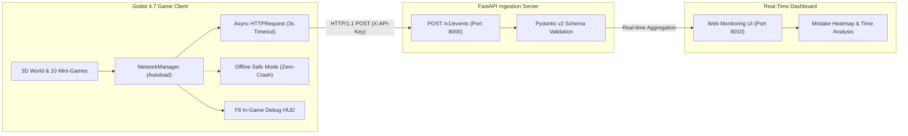

# 🌐 NODEVERSE — 연결된 배움의 세계 (Nodeverse Game)

미니게임은 **자료구조·알고리즘·SQL·데이터 탐색**의 4개 분야, 23개 실습과 자료구조 종합 보너스 1개로 구성되어 있습니다. 현재 목록과 신규 실습 조작법은 [미니게임 가이드](MINIGAME_GUIDE.md)를 참고하세요.

[](https://godotengine.org)
[](https://www.python.org)
[](https://fastapi.tiangolo.com)
[](#실시간-학습-데이터-파이프라인-아키텍처)

> **"배움이 모험이 되는 작은 세계"**  
> 7개의 연결된 3D 메타버스 섬과 10가지 2D 자료구조 도트 미니게임을 탐험하며,  
> 비동기 실시간 텔레메트리 파이프라인으로 학습 데이터를 수집·분석하는 교육용 게임 플랫폼입니다.

---


`reference/NODEVERSE_연결섬_전체지도.png`를 기준으로 4개 섬을 다리로 연결한 플레이 가능한 3D 월드와,
그 월드를 구성하는 모듈형 3D 에셋 70종(GLB + TSCN)을 담은 프로젝트입니다.

- 월드 실행: `play_game.bat` (메인 씬 `scenes/NodeverseWorld.tscn`)
- 에셋 갤러리: `open_showcase.bat` (`scenes/AssetShowcase.tscn`)
- 에디터: `open_editor.bat`

## 월드 구성 (`scripts/nodeverse_world.gd`)

```
                [알고리즘 섬]  정렬 계단 · 그래프 광장(노드 5 + 연결선) · 미로 정원 · 분기 경로
                      |
 [자료구조 섬] —— [메인 섬] —— [SQL 섬]
 ARRAY 항구·크레인     수정 비콘 · 원형 광장(로봇 시작점)       데이터베이스 탑 · 기록 보관소
 LIST 노드 10→20→30   파란 지붕 주택/작은집 · 게시판 · 가판대   작은 도서관 ×2 · 테이블 ×2 · 합류 수로
 STACK 탑 · QUEUE 벨트  남쪽 부두 + 나무 배
```

| 섬 | 조작 |
|---|---|
| 메인 섬 | 세 방향 아치 다리로 이동 |
| 자료구조 섬 | ARRAY 타일 밟기 / E 교환, LIST E 포인터 따라가기, STACK E Push·Q Pop, QUEUE E Enqueue·Q Dequeue |
| 알고리즘 섬 | E 그래프 BFS 탐색, Q 정렬 계단 |
| SQL 섬 | E 쿼리 실행(JOIN 흐름) |

공통: WASD 이동, Space 점프, Shift 달리기, R 메인 광장 복귀, V 시점 전환, 우클릭 드래그·휠 카메라.

- 물에 빠지지 않음: `player_robot.gd`가 이동 방향 앞쪽(0.35m)에 땅(섬·다리·부두)이 있는지 검사해 바다 쪽 이동을 막습니다. 해안선을 따라 미끄러지듯 이동은 가능합니다. (`-- --edgetest`로 자동 점검)
- 카메라 각도: 최소 15° ~ 최대 80° (`CAM_MIN_PITCH`).
- 바다: 1400m 평면 + 하늘·안개를 먼 바다색과 같게 맞춰 수평선 경계가 보이지 않습니다 (`SEA_FAR`, `OCEAN_SIZE`).

섬 지형은 `scripts/builders/builder_world_terrain.gd`(WorldTerrain)가 1m 블록 셀로 생성합니다
(잔디 상판 + 흙 절벽 + 해안 바위, 충돌 포함). 섬 위치·크기는 `nodeverse_world.gd`의 `ISLANDS` 상수에서 조정합니다.

## 자료구조 스테이지 (2D, 걸어 다니는 구조)

메뉴 `scenes/Main.tscn` → `scenes/stages/ST01_Array.tscn` ~ `ST10_Integrated.tscn`. NPC 설명 → WASD로 로봇 이동 + E 상호작용 → 오른쪽 코드 패널.
ST02~ST10 은 `scripts/play/walk_stage.gd`(공통 틀)와 스테이지별 `scripts/play/stNN_*_stage.gd`(규칙)로 동작합니다.

```bash
python tools/make_sprites.py            # 상자, 토큰, NPC 맵 스프라이트
python tools/make_game_backgrounds.py   # 원화에서 게임이 그리는 물건을 지운 배경 (bg_game.png)
python tools/write_stage_scenes.py      # ST02~ST10 씬 생성 (걷는 영역, 상호작용 지점)
Godot_v4.7.2-stable_win64_console.exe --path . --resolution 1280x720 res://scenes/AutoplayStages.tscn   # 전 스테이지 자동 플레이 검증
```


## 📡 실시간 학습 데이터 파이프라인 아키텍처

NODEVERSE는 게임 내 모든 플레이어의 조작(시작, 블록 이동, 실수, 되돌리기, 클리어 등)을 비동기 표준 스키마 이벤트로 수집하여 분석 서버로 전송합니다.



### 🛡️ 주요 기술적 특징
1. **완전 비동기 논블로킹 (Async Non-Blocking)**:
   - Godot의 `HTTPRequest` 노드를 통해 백그라운드 소켓 통신을 수행하여 60 FPS 화면 렌더링과 플레이어 조작(WASD/E)을 0.001초도 방해하지 않습니다.
2. **오프라인 무중단 안전 모드 (Zero-Crash Fallback)**:
   - 서버 접속 불가, 인터넷 끊김, HTTP 에러(401/422/500) 상황에서도 게임이 튕기거나 멈추지 않고 내부 오프라인 큐로 전환되어 100% 정상 플레이가 보장됩니다.
3. **3초 타임아웃 방어 (Timeout Protection)**:
   - 응답이 지연되는 네트워크 환경에서도 3초 내에 자동으로 연결 시도를 정리하여 리소스 누수를 차단합니다.
4. **인게임 F6 실시간 디버그 패널**:
   - 게임 플레이 중 `F6` 단축키를 눌러 전송 패킷, RTT 지연시간(Latency ms), 서버 연결 상태를 실시간 모니터링할 수 있습니다.

---

## 🎮 10종 자료구조 도트 미니게임 라인업

| ID | 스테이지명 | 자료구조 | 핵심 개념 및 조작 |
|:---:|:---|:---:|:---|
| **ST01** | 순서가 있는 보관소 | **배열 (Array)** | O(1) 인덱스 접근, 연속 메모리 상자 이동 및 삭제 |
| **ST02** | 끊어진 운송로 | **연결 리스트 (Linked List)** | 포인터 케이블 연결, HEAD 이동, 노드 순회 |
| **ST03** | 최근 작업 복구실 | **스택 (Stack)** | LIFO 후입선출, PUSH/POP 및 되돌리기(Undo) 스택 |
| **ST04** | 접수 순서 안내소 | **큐 / 덱 (Queue / Deque)** | FIFO 선입선출, FRONT/REAR 게이트, 양방향 덱 |
| **ST05** | 이름으로 찾는 물품대장 | **해시 테이블 (Hash Table)** | Key-Value 매핑, 해시 함수 버킷, 충돌 체이닝 |
| **ST06** | 계층형 자료실 | **이진 트리 (Binary Tree)** | Root/Leaf 계층 노드 탐색 및 트리 순회(Traversal) |
| **ST07** | 갈림길 창고 | **이진 탐색 트리 (BST)** | 좌소우대(Left<Root<Right) 규칙, O(log N) 빠른 탐색 |
| **ST08** | 긴급 작업 배정실 | **힙 & 우선순위 큐 (Heap)** | 최대/최소 힙, 긴급 작업 우선 배정, Heapify 재구조화 |
| **ST09** | 연결망 조사실 | **그래프 (Graph)** | 정점(Vertex)과 간선(Edge), 네트워크 최단 경로 탐색 |
| **ST10** | 학습 지원 센터 | **통합 실전 (Integrated)** | 복합 자료구조 조합 및 최적 성능 알고리즘 문제 해결 |

---
## 폴더 구조

```
godot_project/
├─ scenes/NodeverseWorld.tscn   연결섬 월드 (메인 씬)
├─ scenes/AssetShowcase.tscn    에셋 70종 갤러리
├─ scenes/assets/               에셋 프리팹 .tscn (01~53, OBJ01~OBJ20)
├─ models/props/                  범용 glTF 2.0 (Blender·Unity 등)
├─ scripts/
│  ├─ nodeverse_world.gd        월드 조립 + 게임플레이
│  ├─ player_robot.gd           플레이어 로봇
│  ├─ asset_catalog.gd          에셋 70종 목록 (id, 한글명, 원본, 빌더)
│  ├─ generate_all_assets.gd    에셋 생성기 (GLB + TSCN + 쇼케이스)
│  └─ builders/                 에셋 빌더 + obj_kit.gd + builder_world_terrain.gd
├─ renders/                     에셋 미리보기, 비교 시트, world_*.png 월드 스크린샷
├─ reference/                   2D 원본 (전체지도, sample-assets 53종, objects 20종, 프롬프트) — Godot import 제외(.gdignore)
├─ shaders/ textures/
└─ tools/make_object_comparison.py   원본 vs 3D 비교 시트 생성
```

## 에셋

| 원본 | 모델 | 빌더 |
|---|---|---|
| `reference/sample-assets` 53종 | `01_robot` ~ `53_sign_queue` (50종) | `builder_chars_props / terrain_nature / structures / data_structs` |
| `reference/objects` 20종 | `OBJ01_house_blue` ~ `OBJ20_sign_algo` (20종) | `builder_village / sql / algorithm / island_signs` |

모든 에셋은 바닥 Y=0, 정면 +Z, 약 1m 단위입니다. 한글 표지판 글자는 생성 시 맑은 고딕 Bold로 메시화되어 GLB에 포함됩니다.

## 다시 생성하기 (godot_project 폴더에서)

```bash
# 새 스크립트 클래스를 추가했다면 먼저 한 번
Godot_v4.7.2-stable_win64_console.exe --headless --path . --import
# 에셋 전체 70종 + 쇼케이스
Godot_v4.7.2-stable_win64_console.exe --headless --path . --script res://scripts/generate_all_assets.gd
# objects 20종만
Godot_v4.7.2-stable_win64_console.exe --headless --path . --script res://scripts/generate_all_assets.gd -- --only=OBJ
# 에셋 미리보기 렌더
Godot_v4.7.2-stable_win64_console.exe --path . --resolution 640x640 res://scenes/PreviewRenderer.tscn -- --only=OBJ
# 월드 스크린샷 (renders/world_*.png)
Godot_v4.7.2-stable_win64_console.exe --path . --resolution 1600x900 res://scenes/NodeverseWorld.tscn -- --capture
# 비교 시트
python tools/make_object_comparison.py
```

## 웹 빌드

- 결과물: `build/web/` (index.html + index.wasm + index.pck, 약 85MB)
- 로컬 실행: `serve_web.bat`(= `python tools/serve_web.py`) → 브라우저에서 http://localhost:8060 (file://로 직접 열면 동작하지 않음).
  캐시를 끄고 서빙하므로 다시 빌드해도 예전 파일과 섞이지 않습니다. 로딩이 멈추면 Ctrl+F5로 강력 새로고침하세요.
- 웹에서는 바다 정점 수·그림자 해상도·MSAA를 낮춰 느린 GPU에서도 빨리 시작하게 했습니다.
- 다시 빌드: `Godot_v4.7.2-stable_win64_console.exe --headless --path . --export-release "Web" build/web/index.html`
- 설정: `export_presets.cfg`의 "Web" 프리셋 (스레드 미사용 → 특별한 서버 헤더 없이 일반 웹호스팅에 올려도 동작),
  웹은 Compatibility(WebGL2) 렌더러를 쓰므로 `nodeverse_world.gd`에서 조명을 자동 보정합니다.
- 한글 UI는 `fonts/NotoSansKR-VF.ttf`(SIL Open Font License)를 프로젝트 기본 폰트로 사용합니다.
- 내보내기 템플릿: `%APPDATA%\Godot\export_templates\4.7.2.stable\` (웹 템플릿만 설치됨)

## 백업

`../_archive/` — `godot_project_before_merge_20261104`(통합 전 이 프로젝트), `asset-modeling_20261104`(이전 작업 폴더).
