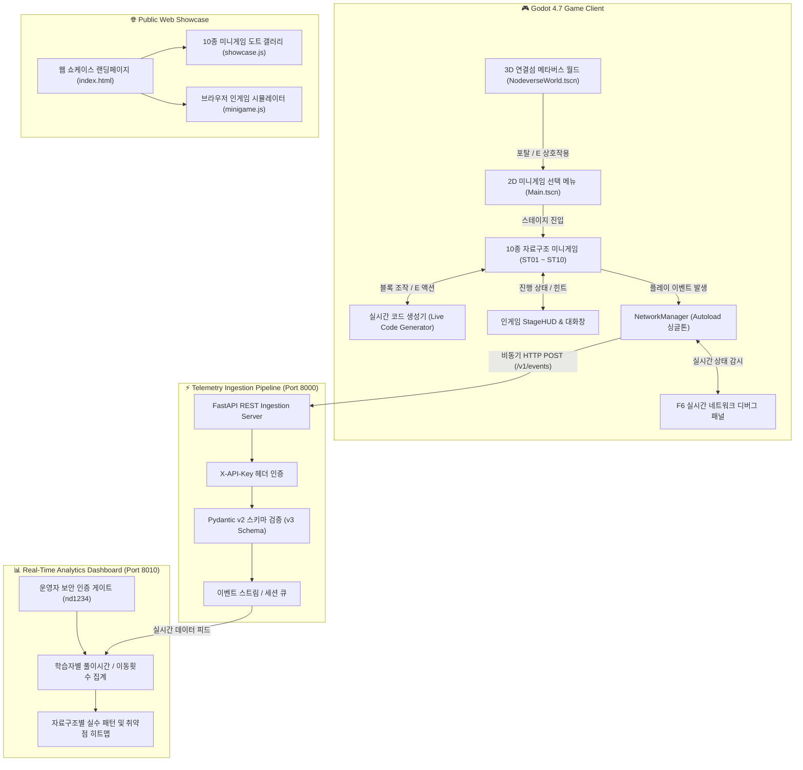
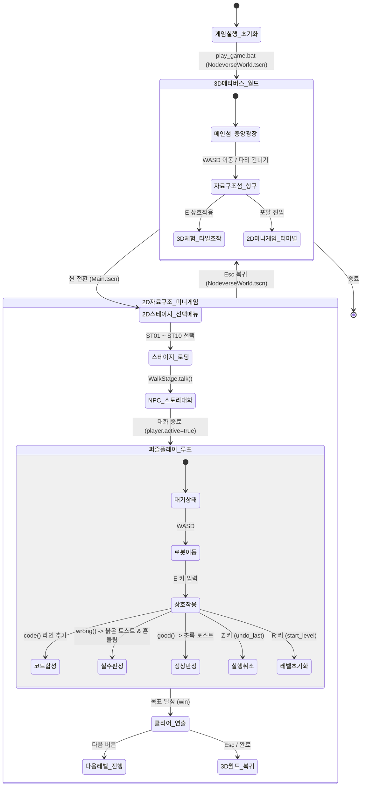
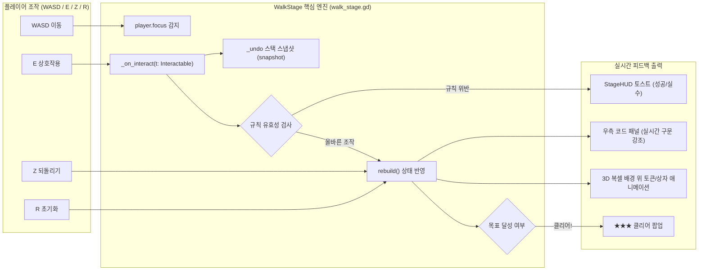
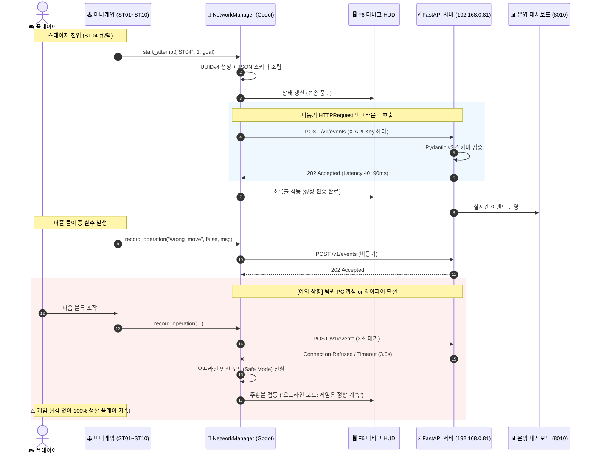

# 🌐 NODEVERSE 게임 동작 흐름 및 시스템 아키텍처

> **버전:** v1.0.0  
> **엔진 및 기술 스택:** Godot 4.7.2 (Forward+ / Vulkan), GDScript, Python 3.13, FastAPI, REST API (X-API-Key)  
> **문서 목적:** 3D 메타버스 월드, 10종 2D 자료구조 미니게임, 실시간 코드 합성기, 비동기 텔레메트리 데이터 파이프라인의 전체 동작 흐름을 시각화하고 정리합니다.

---

## 1. 전체 시스템 조감도 (System Architecture Overview)

NODEVERSE는 크게 **클라이언트(Godot 4.7)**, **백엔드 수집 서버(FastAPI)**, **운영 대시보드(Web UI)**, **공개 웹 쇼케이스**의 4개 계층으로 유기적으로 연결되어 동작합니다.

---

## 2. 플레이어 시점 게임 라이프사이클 흐름 (Game Lifecycle Flow)

플레이어가 게임을 실행하고 3D 월드에서 2D 미니게임으로 진입하여 학습을 마치기까지의 단계별 상태 머신입니다.

---

## 3. 2D 미니게임 내부 코어 루프 & 실시간 코드 생성 (Gameplay Loop)

`scripts/play/walk_stage.gd`를 기반으로 구동되는 10개 미니게임의 내부 메커니즘입니다.

### 💡 실시간 코드 합성기 (Live Code Synthesis) 특징
* 플레이어가 블록을 옮길 때마다 우측 코드 패널에 `Java / C / Python` 스타일의 표준 자료구조 제어 코드가 한 줄씩 타이핑되듯 생성됩니다.
* **실시간 동기화:**
  * 배열 상자 이동 ➔ `arr[3] = arr[2];`
  * 연결 리스트 케이블 연결 ➔ `curr.next = nodeB;`
  * 큐 손님 안내 ➔ `queue.enqueue(D);`, `served = queue.dequeue();`
  * 스택 되돌리기 ➔ `stack.push(action);`, `stack.pop();`
* **시각적 하이라이트:** 방금 실행된 최신 라인은 노란빛 배경(`[bgcolor=#3a3f1e]`)으로 강조되며, 자료구조 키워드(`int`, `null`, `while`, `new` 등)는 파란색으로 자동 구문 강조됩니다.

---

## 4. 비동기 텔레메트리 & 오프라인 안전 파이프라인 (Telemetry Pipeline)

플레이어의 플레이 데이터가 팀원 PC(FastAPI)로 전송되는 시퀀스 흐름과 예외 처리 구조입니다.

### 🛡️ 4중 예외 방어 설계 (Fault Tolerance)
1. **Zero-Crash 보장:** 네트워크 실패 시 `_handle_network_failure`가 호출되어 상태 플래그만 변경할 뿐, Godot 메인 스레드에 예외(Exception)를 전파하지 않습니다.
2. **논블로킹 프레임 유지:** Godot 엔진의 OS 비동기 네트워크 스레드를 사용하여 60 FPS 화면 갱신과 캐릭터 움직임에 랙이 발생하지 않습니다.
3. **3초 타임아웃 킬스위치:** 상대 PC가 응답이 없어도 최대 3초 후 강제 정리되어 메모리 누수가 없습니다.
4. **F6 인게임 실시간 HUD:** 개발자나 플레이어가 언제든 `F6`을 눌러 RTT 응답시간과 전송 상태를 투명하게 모니터링할 수 있습니다.

---

## 5. 10종 자료구조 미니게임 데이터 매핑 명세

| 스테이지 ID | 게임명 | 학습 자료구조 | 핵심 수집 이벤트 | 성공 조건 |
|:---:|:---|:---:|:---|:---|
| **ST01** | 순서가 있는 보관소 | **배열 (Array)** | `slot_move`, `bin_delete`, `wrong_move` | 연속 인덱스 빈틈없이 정렬 |
| **ST02** | 끊어진 운송로 | **연결 리스트 (Linked List)** | `cable_connect`, `head_move`, `node_cycle` | HEAD부터 null까지 단방향 완주 |
| **ST03** | 최근 작업 복구실 | **스택 (Stack)** | `stack_push`, `stack_pop`, `undo_action` | LIFO 순서로 최근 작업 역순 복구 |
| **ST04** | 접수 순서 안내소 | **큐 / 덱 (Queue / Deque)** | `enqueue_rear`, `dequeue_front`, `deque_both` | FIFO 손님 배정 및 응급 손님 덱 처리 |
| **ST05** | 이름으로 찾는 물품대장 | **해시 테이블 (Hash Table)** | `hash_calc`, `bucket_insert`, `collision_resolve` | Key 문자열 해시 매핑 및 체이닝 |
| **ST06** | 계층형 자료실 | **이진 트리 (Binary Tree)** | `tree_node_visit`, `traversal_step` | 부모-자식 트리 순회(전위/중위/후위) |
| **ST07** | 갈림길 창고 | **이진 탐색 트리 (BST)** | `bst_compare_left`, `bst_compare_right` | 좌소우대(Left<Root<Right) 탐색 경로 완성 |
| **ST08** | 긴급 작업 배정실 | **힙 (Heap)** | `heapify_swap`, `root_extract_max` | 최대값 노드 Root 배치 (완전 이진 트리) |
| **ST09** | 연결망 조사실 | **그래프 (Graph)** | `vertex_select`, `edge_traverse`, `bfs_step` | 인접 노드 최단 경로 탐색 및 연결 |
| **ST10** | 학습 지원 센터 | **통합 실전 (Integrated)** | `struct_select`, `multi_pipeline_solve` | 상황별 최적 자료구조 선택 및 종합 해결 |

---

## 6. 결론 및 산출물 가치

* **플레이어:** 3D 오픈월드 탐험과 귀여운 2D 도트 퍼즐을 통해, 지루하게 암기하던 자료구조를 온몸으로 직접 조작하고 체득합니다.
* **운영자/교수자:** 플레이어가 어디서 막히고 어떤 오답을 내는지 실시간 텔레메트리 파이프라인으로 정확히 측정하여 맞춤형 교육 피드백을 제공할 수 있습니다.
* **소프트웨어 완성도:** 비동기 네트워크 파이프라인, 제로 크래시 오프라인 안전 모드, 반응형 웹 쇼케이스까지 갖춘 상용 인디게임 수준의 엔드투엔드(End-to-End) 아키텍처를 보유하고 있습니다.
